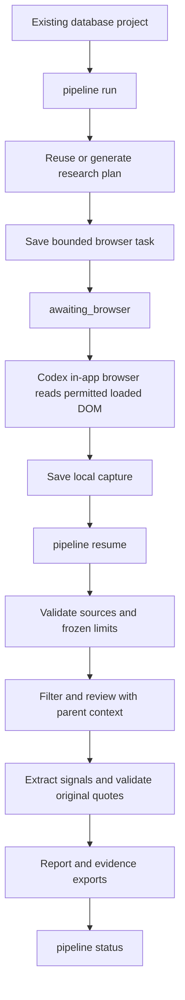

# Reddit Market Intelligence

A Python CLI that turns permitted Reddit discussions into source-linked research.
It stores projects and research runs in one database. It validates model output,
preserves source links, and writes Markdown reports and CSV evidence exports.

This public repository contains the reusable workflow, configuration templates,
documentation, and synthetic test fixtures. Private business cases, collected
content, browser captures, research reports, databases, and internal planning
records are excluded.

## Research workflow



The CLI prepares browser tasks and imports captures. Codex executes the in-app
browser task. A standalone CLI returns `awaiting_browser` until a capture is
supplied. Stop at login, verification, or access barriers.

## Install

Requires Python 3.13 or later and `uv`.

```bash
uv sync --frozen
uv run reddit-market-intel --help
uv run pytest -q
uv run ruff check app tests
```

Copy `.env.example` to a private `.env` and configure `DATABASE_URL`.
For database and project setup, see [First run](docs/first-run.md).

## Run research

Set `PROJECT_ID` to the ID printed when your database project is created or imported.

```bash
uv run reddit-market-intel pipeline run \
  --project-id "$PROJECT_ID" --source builtin-browser-dom \
  --max-items 100 --max-analysis-items 30 \
  --max-queries 1 --max-requests 12 \
  --max-model-calls 65 --max-seconds 1800 \
  --output-dir outputs/research
```

Read the returned `status`, `artifacts.browser_task`, and `next_command`.
Execute the saved browser task in Codex. Then use `next_command` with the actual
capture path. Use `pipeline status --project-id "$PROJECT_ID"` to locate results.

The pipeline defaults to the configured authenticated Codex CLI. An optional
Responses endpoint can provide model calls. Model access and Reddit access use
separate configuration. `--dry-run` does not call models or sources or save state.

## Source modes

| Source | Input and boundary |
|---|---|
| `builtin-browser-dom` | Codex in-app browser handoff; reads loaded original content |
| `browser-dom` | Optional `agent-browser` connection to a prepared task-owned browser |
| `reddit-api` | Configured read-only Reddit OAuth access |
| `public-json` | Explicit opt-in; stops on access denial |
| `auto` | Configured OAuth, then explicitly enabled browser DOM or public JSON |
| `imported` | Previously imported local evidence; no Reddit request |
| `existing` | Bounded stored project evidence; no Reddit request |

The pipeline does not switch sources after an access denial. No-key access still
uses web interfaces. It does not prove access authorization or complete comments.

## Evidence and recovery

Runs preserve frozen plans, time windows, source scope, budgets, and stage state.
`pipeline resume` reuses complete unchanged stages. Failed attempts count toward
the original model budget. Previous failed runs and reports remain available.

Comments receive same-project parent context when known. Quotes must match the
current record's own original text. Reports use the current extraction scope.
Missing values and comment coverage remain explicit. Qualitative signals do not
establish market size, representative demand, or willingness to pay.

Automated tests use synthetic fixtures, mocked providers, and local SQLite.
Passing tests does not validate live Reddit access, model quality, or PostgreSQL.
The migration chain has a known duplicate-table issue on fresh SQLite databases;
see the setup notes before using it.

## Guides

- [Research run guide](docs/run-research.md): start, collect, resume, inspect.
- [In-app browser handoff](docs/builtin-browser-research.md): capture contract and coverage.
- [Providers and budgets](docs/autonomous-pipeline.md): model configuration and other sources.
- [Local export import](docs/no-key-export-import.md): JSON/CSV fields and source provenance.
- [Quality coverage](docs/quality-coverage.md): offline verification boundaries.
- [Access and data handling](docs/compliance.md): read-only scope and retention guidance.

Runtime artifacts stay local under `outputs/`. Do not commit credentials or
collected content. The system does not automate posting, comments, messages,
voting, account operation, or hidden promotion.
