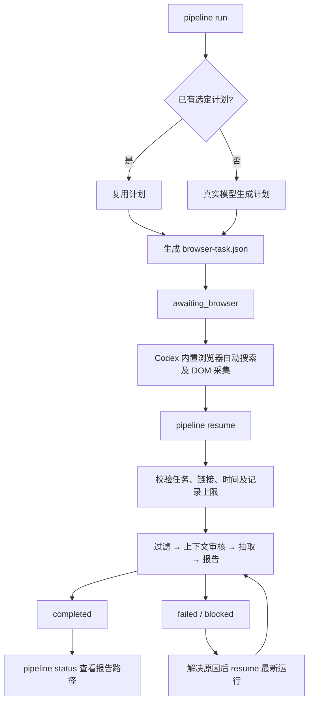

# 研究运行指南

默认操作路径：**启动 → Codex 内置浏览器采集 → 续跑 → 查看报告**。复用现有数据库、项目、研究计划和模型配置。每次运行使用独立输出目录，旧数据和旧报告保留。



## 1. 一次性准备

从仓库根目录运行命令。使用现有 `.env` 或环境变量中的 `DATABASE_URL`。不要每次创建数据库、重复导入项目或复制登录文件。

```bash
uv sync
uv run reddit-market-intel --help
```

已有数据库项目直接进入下一步。新项目先设置自己的 `RESEARCH_TOPIC` 和 `RESEARCH_REGION`，再创建并导入一次：

```bash
uv run reddit-market-intel projects create \
  --topic "$RESEARCH_TOPIC" --region "$RESEARCH_REGION" \
  --language en --language de --access-mode personal
uv run reddit-market-intel projects import-json
```

使用与数据库匹配的注册表，将 `PROJECT_ID` 设为命令输出的项目 ID；不要用独立注册表覆盖已有项目。数据库初始化和授权 OAuth 路径见 [首次运行指南](first-run.md)。真实模型默认复用已有 Codex 登录及 `REAL_MODEL_PROVIDER` / `REAL_MODEL`；也可以复用已配置的 Responses 服务。模型配置与 Reddit 取数凭据独立。

## 2. 启动研究

```bash
uv run reddit-market-intel pipeline run \
  --project-id "$PROJECT_ID" --source builtin-browser-dom \
  --max-items 100 --max-analysis-items 30 \
  --max-queries 1 --max-requests 12 \
  --max-model-calls 65 --max-seconds 1800 \
  --output-dir outputs/research
```

没有采集文件时，命令自动生成任务并返回 `awaiting_browser`。输出包含 `run_id`、`artifacts.browser_task`、`summary_path` 和可直接使用的 `next_command`。这是等待浏览器采集，不是完成研究。

`max-requests` 为任务中的搜索页和讨论页预留总数；浏览器内部 HTTP 请求数仍未知。

时间窗口默认是当前 UTC 时间之前的 365 天。任务生成后冻结窗口。需要指定本地时间时，将 `SINCE` 和 `UNTIL` 设为带时区的 ISO 时间后传入：

```bash
uv run reddit-market-intel pipeline run \
  --project-id "$PROJECT_ID" --source builtin-browser-dom \
  --since "$SINCE" \
  --until "$UNTIL" \
  --max-items 100 --max-analysis-items 30 \
  --max-model-calls 65 --max-seconds 1800
```

已有选定计划时，准备采集任务不调用模型。没有计划时，真实规划调用计入本次预算。`--dry-run` 不调用模型、浏览器或源接口，不写数据库和文件。

`max-items` 控制保留的采集记录数。`max-analysis-items` 控制分析样本数；省略时使用全部当前范围。选择顺序为帖子优先，再按采集顺序选择评论，存在顺序偏差。原始采集记录仍保留，不能将模型样本量当作完整语料量。

## 3. 由 Codex 执行浏览器任务

让 Codex 读取生成的 `browser-task.json` 并执行其中的采集说明。使用 GPT 内置浏览器。自动读取计划搜索结果，访问观察到的讨论链接，读取原帖和已加载评论。无需人工搜索或填写模型结果。

采集工具只需保存页面观测结果：

```json
{"searches": [], "discussions": []}
```

上例是空观测结构；真实结果必须填入工具返回的页面快照。`resume` 自动附加已冻结的原任务，省去手工合并步骤。结果文件通常保存为任务目录下的 `browser-capture.json`；也可直接传入采集工具保存的 `dom-observations.json`。含完整 `task` 的旧格式仍支持，但必须与已冻结任务一致。不能改变运行 ID、窗口、查询或上限来扩大范围。需要改动时新建运行。

内置浏览器工具由 Codex 执行，独立 CLI 不能直接控制它。验证或登录阻塞需要人工获得访问许可。完整评论树仍不自动补全。字段、DOM 解析和覆盖规则见 [内置浏览器说明](builtin-browser-research.md)。

## 4. 续跑和恢复

直接使用启动输出的 `next_command`，或将 `RUN_ID` 和 `CAPTURE_PATH` 设为实际运行 ID 和采集路径：

```bash
uv run reddit-market-intel pipeline resume \
  --run-id "$RUN_ID" \
  --browser-capture-path "$CAPTURE_PATH"
```

该命令复用启动时的配置、窗口和预算。无需重新填写项目、模型和上限。完成的阶段会被复用。新建的续跑记录关联原运行；原失败状态保持不变。

失败阶段修复后，按最新运行 ID 继续：

```bash
uv run reddit-market-intel pipeline resume --run-id "$RUN_ID" --dry-run
uv run reddit-market-intel pipeline resume --run-id "$RUN_ID"
```

只复用完整完成的阶段。失败阶段可能重做部分已处理记录，但所有模型尝试累计计入同一上限。预算耗尽不会自动重置。活动执行时间累计计入原时间预算，命令之间等待人工验证和采集的时间不计入 CLI 活动时间；内置浏览器执行时间并非 CLI 测得的活动时间。

项目研究上下文、计划、正文、父级上下文或已验证审核发生变化时，拒绝复用旧阶段，需新建运行。旧版本缺少来源检查点的失败运行也需要新建运行。已有完成结果再次续跑只返回原结果，不再调用模型。若原运行已有续跑记录，使用提示的最新运行 ID。

| 状态 | 含义 | 下一步 |
|---|---|---|
| `awaiting_browser` | 任务已准备，等待采集 | 执行内置浏览器任务，再提供结果文件 |
| `running` | 运行尚未结束 | 查询状态；不要重复启动续跑 |
| `blocked` | 访问、模型配置或预算阻塞 | 解决原因；预算耗尽需要重新明确新运行预算 |
| `failed` | 数据、模型结果或阶段执行失败 | 查看原因，修复后续跑 |
| `no_evidence` | 没有新增证据或有效信号 | 检查范围；不要把旧信号替代为成功结果 |
| `completed` | 报告和证据导出完成 | 查看结果路径 |

## 5. 查看运行与报告

```bash
# 项目的最新运行
uv run reddit-market-intel pipeline status --project-id "$PROJECT_ID"

# 指定运行，包括历史失败记录
uv run reddit-market-intel pipeline status --run-id "$RUN_ID"
```

状态查询不调用模型或浏览器。输出显示已提交状态、采集量、分析量、信号数、累计模型调用数，以及报告和证据路径。它不是单个模型调用的实时进度。

每个新运行目录包含 `run-summary.json`。最终产物为 `market-report.md`、证据 Markdown 和 CSV。所有信号和引文只来自当前运行或明确复用的已完成抽取阶段。评论判断带父帖和已知直接父评论；引文只能来自本评论自己的正文。

`run` 和 `resume` 在 `completed`、`dry_run`、`awaiting_browser` 时返回退出码 0。其余终态返回 1。自动调用方必须检查 JSON `status`，不能仅凭退出码判断报告已经完成。`status` 命令的退出码表示查询是否成功。
